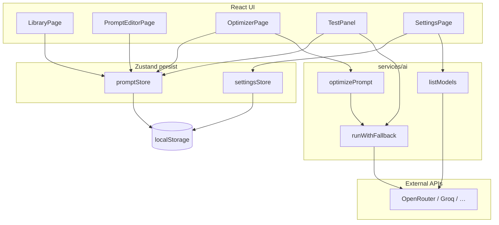

# AI Prompt Studio — документация для разработчиков

Этот документ помогает быстро понять проект, стек и внутреннюю логику. Пользовательская краткая справка — в [README.md](../README.md).

---

## 1. Что за проект

**AI Prompt Studio** — одностраничное веб-приложение (SPA) для работы с AI-промптами: создание, шаблоны, переменные `{{name}}`, версионирование, тестовые прогоны через внешние API и **оптимизатор** (сырой запрос → структурированный промпт в JSON → сохранение в библиотеку).

### Ключевые свойства архитектуры

| Свойство | Описание |
|----------|----------|
| **Клиент-only** | Нет собственного бэкенда. Все данные и API-ключи — в браузере (`localStorage`). |
| **MVP / pet project** | Фокус на UX и полном цикле «промпт → версия → тест», а не на multi-user или облачной синхронизации. |
| **Типы промптов** | `text`, `code`, `image` — разный UI (например, code review workspace для `code`). |

### Основные пользовательские сценарии

1. **Библиотека** — список промптов, фильтры, создание с нуля или из шаблона (`PROMPT_TEMPLATES`).
2. **Редактор** (`/prompts/:id`) — черновик промпта, переменные, preview подстановки, история версий, diff/restore, тест.
3. **Оптимизатор** (`/optimizer`) — LLM превращает текст запроса в `OptimizerResult` (JSON), пользователь правит и сохраняет новый промпт или обновляет существующий.
4. **Коллекции** — группировка промптов (many-to-many через `collectionIds` на промпте и `promptIds` на коллекции).
5. **Импорт / экспорт** — JSON bundle (`ExportBundle`, `schemaVersion: 1`).
6. **Настройки** — провайдеры AI, ключи, каталог моделей, fallback на Mock.

---

## 2. Стек, инструменты и библиотеки

### Язык и сборка

| Инструмент | Назначение |
|------------|------------|
| **TypeScript** (~6, `strict`) | Типизация, `noEmit` — проверка через `tsc` при сборке |
| **Vite 6** | Dev-сервер, HMR, production bundle |
| **@vitejs/plugin-react** | JSX, Fast Refresh |
| **Vitest** | Unit-тесты (`src/**/*.test.ts`, среда `node`) |

Скрипты из `package.json`:

```bash
npm run dev      # разработка
npm run build    # tsc && vite build → dist/
npm run preview  # просмотр production-сборки
npm test         # vitest run
```

### UI

| Библиотека | Назначение |
|------------|------------|
| **React 19** | Компоненты, hooks |
| **react-router-dom 7** | Маршрутизация (`createBrowserRouter`) |
| **Tailwind CSS 4** (`@tailwindcss/vite`) | Utility-классы, тема |
| **Sass** (`src/style.scss`) | Доп. глобальные стили поверх Tailwind |
| **sonner** | Toast-уведомления |
| **react-markdown** | Рендер ответа модели в тест-панели |
| **diff** | Diff между версиями промпта |

Брендинг: основной цвет `#fca30c` (классы `primary`, `bg-primary` и т.д. в Tailwind-конфигурации через CSS-переменные в `tailwind.css`).

### Состояние и данные

| Библиотека | Назначение |
|------------|------------|
| **Zustand** + **persist** | Глобальное состояние с записью в `localStorage` |
| **Zod** | Схемы сущностей и валидация (экспорт, optimizer JSON) |
| **uuid** | Генерация id (`src/lib/id.ts`) |

Ключи persist:

- `ai-prompt-studio-data` — промпты, версии, коллекции, test runs (`promptStore`)
- `ai-prompt-studio-settings` — провайдеры, ключи, каталог моделей (`settingsStore`, migrate v4)

### Сеть (AI)

Запросы идут **напрямую из браузера** к API провайдеров (`fetch`). CORS должен быть разрешён на стороне провайдера (OpenRouter, Groq и т.д.).

---

## 3. Структура репозитория

```
AI-Prompt-Studio/
├── index.html              # точка входа HTML
├── vite.config.ts          # Vite + Tailwind + Vitest
├── tsconfig.json
├── src/
│   ├── main.tsx            # React root, Router, Toaster
│   ├── app/
│   │   ├── Layout.tsx      # боковое меню, <Outlet />
│   │   └── routes.tsx      # маршруты
│   ├── features/           # страницы и feature-компоненты (по доменам)
│   │   ├── library/
│   │   ├── prompts/
│   │   ├── optimizer/
│   │   ├── test-run/
│   │   ├── settings/
│   │   ├── import-export/
│   │   └── guide/
│   ├── components/         # переиспользуемый UI (Button, ModelSelect, …)
│   ├── stores/             # Zustand: promptStore, settingsStore
│   ├── schemas/            # Zod-схемы и типы домена
│   ├── services/ai/        # вызовы LLM: run, optimize, listModels, translate
│   └── lib/                # чистая логика без React (variables, providers, …)
└── docs/
    └── DEVELOPER.md        # этот файл
```

**Соглашение:** UI и оркестрация — в `features/` и `components/`; бизнес-правила и парсинг — в `lib/`; HTTP к AI — в `services/ai/`; единый источник типов домена — `schemas/index.ts`.

---

## 4. Логика работы проекта

### 4.1. Маршруты и оболочка

```text
/                    → LibraryPage
/optimizer           → OptimizerPage
/collections         → CollectionsPage
/prompts/:id         → PromptEditorPage
/import-export       → ImportExportPage
/settings            → SettingsPage
/guide               → GuidePage
```

`Layout` ренерит навигацию и `<Outlet />`. Страницы оборачиваются в `PageShell` для единообразных отступов и заголовков.

### 4.2. Модель данных

Сущности описаны в `src/schemas/index.ts`:

| Сущность | Смысл |
|----------|--------|
| **Prompt** | Текущий черновик: `title`, `kind`, `body`, `variables`, `tags`, `collectionIds`, `currentVersionId`, опционально `optimizerMeta` |
| **PromptVersion** | Снимок `body` + `variablesSnapshot` на момент сохранения; `label` (`v1`, `v2`, …), `message` |
| **Collection** | Имя, описание, список `promptIds` |
| **TestRun** | История прогонов (до 100 записей): provider, model, подставленные переменные, ответ, latency |
| **ExportBundle** | `schemaVersion: 1` + массивы collections, prompts, versions |
| **OptimizerResult** | Ответ оптимизатора до присвоения id (title, kind, body, variables, tags, explanation, tips) |

**Важно:** «живое» состояние промпта — это объект в `prompts[id]`. Версии — append-only снимки в `versions`. `currentVersionId` указывает на последнюю сохранённую версию, но редактирование идёт в черновике до следующего `saveVersion`.

### 4.3. Store промптов (`promptStore`)

Центральный API для данных приложения:

| Метод | Поведение |
|-------|-----------|
| `createPrompt` | Новый prompt + первая версия `v1`; синхронизирует переменные из `body` через `parseVariablesFromBody` |
| `updatePromptDraft` | PATCH черновика; при смене `body` — пересбор списка переменных (сохраняет metadata существующих имён) |
| `saveVersion` | Новая запись в `versions`, обновление `currentVersionId` |
| `restoreVersion` | Копирует снимок в черновик + создаёт новую версию с сообщением restore |
| `applyOptimizerResult` | `create` или `update` промпта из результата оптимизатора; тег `optimized`, merge переменных |
| `createFromTemplate` | Обёртка над `createPrompt` для `PROMPT_TEMPLATES` |
| `importBundle` / `exportAll` | Merge strategies: `skip`, `replace`, `copy` (copy — новые UUID) |

При первом запуске в store есть **демо-промпт** («Приветственный промпт»).

Флаг `hydrated` выставляется после rehydrate из localStorage — при необходии можно не ренерить критичный UI до гидратации (сейчас используется минимально).

### 4.4. Переменные `{{name}}`

Логика в `src/lib/variables.ts`:

- Плейсхолдеры: `\{\{\s*([a-zA-Z_][a-zA-Z0-9_]*)\s*\}\}`
- `normalizeVariablePlaceholders` — одинарные `{name}` → `{{name}}`
- `parseVariablesFromBody` — уникальные имена из текста
- `substituteVariables` — подстановка для preview и test run; неизвестные имена остаются как `{{name}}`

Формат поля в UI (`text` / `code` / `multiline`) — `inferVariableFormat` в `variableFormat.ts`. Слияние переменных оптимизатора с телом — `mergePromptVariables.ts`.

### 4.5. Настройки и провайдеры AI

**Реестр провайдеров** — `src/lib/aiProviders/registry.ts`:

| id | Transport | Ключ / URL |
|----|-----------|------------|
| `mock` | локальная симуляция | не нужен |
| `openrouter` | OpenAI Chat Completions | `openRouterKey` |
| `groq` | OpenAI Chat Completions | `groqKey` |
| `anthropic` | Anthropic Messages API | `anthropicKey` |
| `openai_compatible` | OpenAI Chat на custom base URL | `openaiCompatibleBaseUrl`, ключ опционален (Ollama) |

`settingsStore` хранит активный провайдер, ключи, `defaultModels`, флаг `useMockWhenNoKey`, кэш **model catalog** (`refreshModelCatalog` → `services/ai/listModels.ts`).

**Сборка контекста запроса:** `buildCompletionContext(settings, provider)` → `{ apiKey?, openAiBaseUrl? }`.

### 4.6. Выполнение completion (`runPrompt.ts`)

```text
runWithFallback(req, { useMockWhenNoKey })
    │
    ├─ нет ключа / base URL → mockComplete (если флаг включён)
    │
    └─ runCompletion(req)
           ├─ mock        → mockProvider
           ├─ anthropic   → anthropicCompatible
           └─ openai-chat → openaiCompatible (+ OpenRouter headers)
```

При ошибке реального провайдера и включённом mock-fallback ответ дополняется предупреждением и mock-текстом.

**TestPanel** (`features/test-run/TestPanel.tsx`):

1. Подставляет переменные в `body`.
2. Для `code` / review-тегов может добавить `CODE_REVIEW_SYSTEM_PROMPT`.
3. Вызывает `runWithFallback`, показывает markdown-ответ, пишет `addTestRun`.

### 4.7. Оптимизатор

Поток:

```text
Пользователь вводит rawRequest (+ kindHint, язык, image target)
        │
        ▼
optimizePrompt(input, options)  [services/ai/optimizePrompt.ts]
        │
        ├─ shouldUseMockOptimizer → mockOptimizerResult (шаблонные ответы)
        │
        └─ runWithFallback(system: OPTIMIZER_SYSTEM_PROMPT, user: buildUserMessage)
                │
                ▼
        parseOptimizerJson(completion.content) → OptimizerResult
                │
                ▼
        postProcessOptimizerResult (подсказки для image / non-English)
        │
        ▼
Пользователь редактирует editable result на OptimizerPage
        │
        ▼
applyOptimizerResult(rawRequest, result, 'create' | 'update', promptId?)
        │
        └─ navigate → /prompts/:id (state: fromOptimizer, initialTab)
```

Сессия оптимизатора может сохраняться в `sessionStorage` через `optimizerSession.ts` (чтобы не потерять черновик при перезагрузке).

**Refine mode:** из редактора промпта можно отправить текущий body обратно в оптимизатор (`optimizerRefine.ts`, navigation state с `fromPromptId`, `refineBody`).

### 4.8. Image-промпты

- Шаблоны секций: `imagePromptTemplate.ts`, шаблон в `templates.ts` (`image-prompt`).
- Язык текста промпта: `promptLanguage.ts` (опции UI, предупреждения для EN-генераторов).
- **ImagePromptGeneratorBar** — preview + перевод в EN через `translateImagePrompt.ts` (отдельный system prompt для image models).
- Редактор предупреждает, если язык body и defaultValue переменных не согласованы.

### 4.9. Code-промпты

- `kind === 'code'` открывает вкладку **Ревью** (`CodeReviewWorkspace`) — удобный ввод кода в переменную `code` и пресеты фокуса (`codeReviewPresets.ts`).
- Тест может использовать отдельный system message для code review.

### 4.10. Версии и diff

`VersionsPanel` загружает версии через `getVersionsForPrompt` (сортировка по дате). Библиотека `diff` используется для сравнения тел версий. Restore не откатывает историю — создаёт новую версию поверх восстановленного черновика.

### 4.11. Импорт и экспорт

- `exportAll` / `exportCollection` формируют `ExportBundle`.
- Импорт валидируется через Zod (`exportBundleSchema`); стратегии merge описаны в `importBundle`.
- Тесты схемы: `src/schemas/export.test.ts`.

---

## 5. Диаграмма потоков данных (высокий уровень)



---

## 6. Как добавлять функциональность

### Новый шаблон промпта

Добавить объект в `PROMPT_TEMPLATES` (`src/lib/templates.ts`): `body` с `{{variables}}`, массив `variables`, `kind`, `tags`.

### Новый провайдер AI

1. Расширить `aiProviderSchema` и `Settings` в `schemas/index.ts`.
2. Добавить запись в `AI_PROVIDER_DEFINITIONS` (`registry.ts`): transport, URL, `settingsKey`.
3. При необходимости — ветка в `runCompletion` или новый adapter в `services/ai/`.
4. Обновить `defaultModels`, migrate в `settingsStore`, UI в `ProviderSettingsSection`.
5. Если есть catalog API — `listModels.ts` и типы в `modelCatalogTypes.ts`.

### Новая страница

1. Компонент в `src/features/...`.
2. Route в `src/app/routes.tsx`.
3. Пункт меню в `Layout.tsx` (`navItems`).

### Новая pure-логика

Предпочтительно в `src/lib/` + unit-тест `*.test.ts` рядом или в том же модуле.

---

## 7. Тестирование

Покрытие точечное, без e2e:

| Файл | Что проверяет |
|------|----------------|
| `lib/variables.test.ts` | парсинг и подстановка переменных |
| `lib/mergePromptVariables.test.ts` | merge после оптимизатора |
| `lib/parseOptimizerJson.test.ts` | разбор JSON от LLM |
| `lib/promptLanguage.test.ts` | языковые эвристики для image |
| `lib/providerModels.test.ts` | выбор модели по каталогу |
| `services/ai/listModels.test.ts` | парсинг ответов catalog API |
| `services/ai/translateImagePrompt.test.ts` | перевод image prompt |
| `schemas/export.test.ts` | валидация export bundle |

Запуск: `npm test`.

---

## 8. Безопасность и ограничения

- API-ключи **никогда не должны** попадать в git; хранятся только в localStorage пользователя.
- Любой пользователь с доступом к машине может прочитать ключи из DevTools — это ожидаемо для client-only MVP.
- Rate limits и биллинг — на стороне выбранного провайдера.
- CORS: при добавлении нового endpoint убедитесь, что браузер может вызывать API.

---

## 9. Деплой

Static SPA после `npm run build` → каталог `dist/`. Для GitHub Pages может понадобиться `base` в `vite.config.ts` и rewrite на `index.html`. Подробности — в README.

---

## 10. Быстрый чеклист для нового разработчика

1. `npm install && npm run dev` — открыть приложение, пройти демо-промпт.
2. Прочитать `schemas/index.ts` — понять доменные типы.
3. Прочитать `promptStore.ts` — понять жизненный цикл промпта и версий.
4. Прочитать `registry.ts` + `runPrompt.ts` — понять, как уходят запросы к AI.
5. Пройти сценарий: **Оптимизатор → сохранить → редактор → тест (Mock) → версия**.
6. Включить реальный ключ в **Настройках**, «Загрузить модели», повторить тест.
7. Перед PR: `npm run build && npm test`.

---

## 11. Связанные файлы (шпаргалка)

| Задача | Файлы |
|--------|--------|
| Роутинг | `src/app/routes.tsx`, `src/app/Layout.tsx` |
| CRUD промптов | `src/stores/promptStore.ts` |
| Настройки / модели | `src/stores/settingsStore.ts`, `src/lib/providerModels.ts` |
| Шаблоны | `src/lib/templates.ts`, `src/lib/imagePromptTemplate.ts` |
| Оптимизатор UI | `src/features/optimizer/OptimizerPage.tsx` |
| Редактор | `src/features/prompts/PromptEditorPage.tsx` |
| LLM optimize | `src/services/ai/optimizePrompt.ts` |
| LLM run | `src/services/ai/runPrompt.ts`, `openaiCompatible.ts`, `anthropicCompatible.ts` |
| Mock | `src/services/ai/mockProvider.ts` |

Если документ устарел относительно кода, ориентируйтесь на типы в `schemas/` и реестр `AI_PROVIDER_DEFINITIONS` как на source of truth для контрактов.
